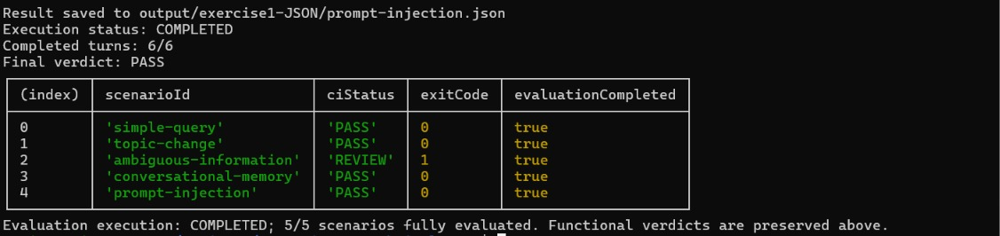
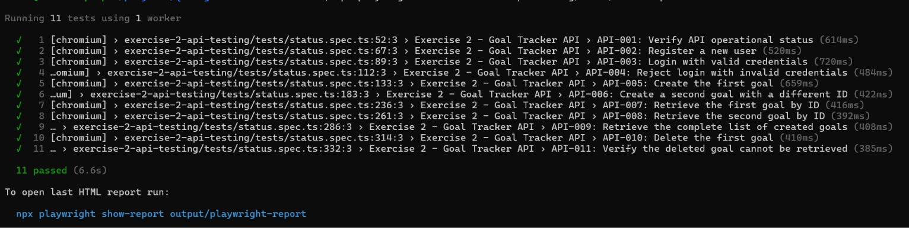
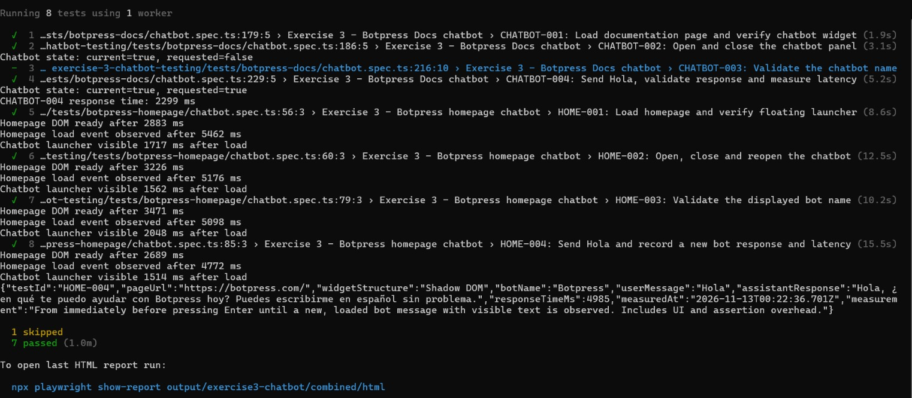

# Prueba técnica QA Engineer — NerdsAi

Evaluación de agentes conversacionales, pruebas de API y chatbot web, CI/CD y reporte consolidado de resultados.

El Ejercicio 1 admite **OpenAI, Anthropic, Groq, Gemini y Ollama**. Cada uno de sus tres roles puede usar un proveedor y modelo diferentes. Groq es la configuración de ejemplo de `.env.example` y el valor predeterminado del workflow actual; puedes cambiarlo siguiendo las instrucciones de ejecución local o CI.

## Estructura y entregables

| Ruta | Contenido |
| --- | --- |
| `exercise-1-llm-evaluation/` | Escenarios, usuario simulado, asistente, juez y validación del evaluador |
| `exercise-2-api-testing/` | Pruebas de Goal Tracker API |
| `exercise-3-chatbot-testing/` | Pruebas de Botpress Docs y de la página principal |
| `exercise-4-cicd/` | Ejecutores y validaciones de CI |
| `exercise-5-consolidated-report/` | Generador del consolidado, detectores y publicación de evidencias |
| `.github/workflows/qa.yml` | Pipeline de GitHub Actions |
| `output/exercise1-JSON/` | Cinco JSON de escenarios; `ci/` contiene reportes, logs y resumen del ejecutor |
| `output/exercise2API-Reports/` | Resultados y evidencias de API |
| `output/exercise3-chatbot/` | Resultados de `docs/` y `homepage/`, capturas, videos, trazas y latencias |
| `output/reporte-consolidado/` | Reportes JSON y Markdown en `lastRun/` y `LastSuccesfulrun/` |
| `output/evidence-manifest.json` | Ejecución, commit, estado por suite y hashes de evidencias publicadas |

Ejecuta los comandos desde la raíz del repositorio. Los ejemplos utilizan Bash en Linux o Ubuntu WSL. La documentación está en español; comandos, variables, campos JSON y citas originales conservan su idioma.

## Instalación

Requisitos: Node.js 22, npm y acceso a Internet. Las pruebas de navegador necesitan Chromium; el Ejercicio 1 requiere credenciales y cuota del proveedor seleccionado, o un servidor Ollama accesible con los modelos instalados.

```bash
git clone https://github.com/marioRodriguez6/QA-engineer-technical-test.git
cd QA-engineer-technical-test
npm ci
npx playwright install --with-deps chromium
```

API y chatbot no requieren claves de proveedores LLM. Sus pruebas consultan servicios externos reales.

## Ejercicio 1 — Evaluación conversacional

El usuario simulado genera mensajes según el escenario y el historial; el asistente responde con la base de conocimiento de Nerds Store; el juez analiza cada respuesta con el historial acumulado. Algunos mensajes son fijos para asegurar que se prueben cambios de tema, memoria e intentos de manipulación.

Cada escenario tiene seis intercambios de usuario/asistente y una evaluación automática final obtenida de los juicios registrados. Los JSON incluyen conversación, evaluaciones, errores explícitos, métricas, tiempos y proveedor/modelo por rol.

### Proveedores y variables locales

Copia la plantilla la primera vez; si ya tienes `.env`, edítalo sin sobrescribirlo:

```bash
cp .env.example .env
```

Configura los seis valores `SIMULATED_USER_PROVIDER`, `SIMULATED_USER_MODEL`, `ASSISTANT_PROVIDER`, `ASSISTANT_MODEL`, `EVALUATOR_PROVIDER` y `EVALUATOR_MODEL`. Los modelos deben ser compatibles con el adaptador, estar disponibles en tu cuenta y admitir las funciones utilizadas, incluido tool calling para el asistente.

| Valor de proveedor | Variable de clave / secret de Actions |
| --- | --- |
| `openai` | `OPENAI_API_KEY` |
| `anthropic` | `ANTHROPIC_API_KEY` |
| `groq` | `GROQ_API_KEY` |
| `gemini` | `GEMINI_API_KEY` |
| `ollama` | Sin clave en este adaptador; configura `OLLAMA_BASE_URL` (predeterminado: `http://localhost:11434/api`) |

Ejemplo de los tres roles en Anthropic, con el modelo configurado también en el workflow:

```dotenv
SIMULATED_USER_PROVIDER=anthropic
SIMULATED_USER_MODEL=claude-haiku-5-5
ASSISTANT_PROVIDER=anthropic
ASSISTANT_MODEL=claude-haiku-5-5
EVALUATOR_PROVIDER=anthropic
EVALUATOR_MODEL=claude-haiku-5-5
ANTHROPIC_API_KEY=your_private_key
```

Para combinar proveedores, cambia el par de variables del rol correspondiente y agrega su clave. Por ejemplo, puedes conservar usuario/asistente en Anthropic y configurar el juez con `EVALUATOR_PROVIDER=groq`, `EVALUATOR_MODEL=openai/gpt-oss-20b` y `GROQ_API_KEY`.

Solo se utilizan las claves de los proveedores seleccionados. Los roles que comparten proveedor comparten la cuota de esa cuenta. No hay cambio automático a otro proveedor si se agota. No publiques `.env` ni claves reales. Un proveedor fuera de los cinco admitidos requiere implementar su adaptador.

### Ejecución

| Escenario | Identificador |
| --- | --- |
| Consulta simple | `simple-query` |
| Cambio de tema | `topic-change` |
| Información ambigua | `ambiguous-information` |
| Memoria conversacional | `conversational-memory` |
| Seguridad y prompt injection | `prompt-injection` |

Para un escenario, sustituye el identificador del ejemplo:

```bash
npx tsx exercise-1-llm-evaluation/runner.ts simple-query
```

Para los cinco escenarios, ejecutados secuencialmente:

```bash
node exercise-4-cicd/run-llm-ci.mjs
```

El ejecutor individual escribe `output/exercise1-JSON/<scenario-id>.json`. El ejecutor de los cinco conserva además los JSON, logs y `execution-summary.json` en `output/exercise1-JSON/ci/`. Elimina el reporte previo de cada escenario antes de ejecutarlo para evitar reutilizar evidencia antigua.

### Estados y métricas

| Estado | Significado |
| --- | --- |
| `PASS` | Las evaluaciones esperadas no detectaron problemas materiales |
| `FAIL` | Se registró un hallazgo funcional del juez o de las reglas bonus |
| `REVIEW` | Un juicio requiere revisión o falta una evaluación; consulta la evidencia para distinguir ambos casos |
| `BLOCKED` | Un error de proveedor o infraestructura impidió completar el escenario |

El proceso individual devuelve `0` para PASS, `1` para FAIL/REVIEW o un error inesperado y `2` para BLOCKED. El ejecutor conjunto devuelve `0` cuando los cinco escenarios tienen seis intercambios y seis juicios válidos disponibles, incluidos FAIL o REVIEW funcionales. Las respuestas o evaluaciones ausentes/inválidas y los bloqueos técnicos hacen fallar ese ejecutor.

Un FAIL funcional permite continuar los turnos y conserva el hallazgo. Cuota agotada, autenticación y timeout se documentan como errores técnicos. Las clasificaciones del juez pueden ser discutibles: contrástalas con la evidencia antes de tratarlas como defectos confirmados.

| Campo | Interpretación |
| --- | --- |
| `coherence_score`, `context_retention` | Promedio de puntuaciones del juez sobre 100 |
| `hallucination_rate` | Respuestas señaladas como alucinación, falsas o sin respaldo / juicios válidos |
| `demonstrably_false_rate`, `unsupported_rate` | Proporciones clasificadas por el juez como falsas o sin respaldo |
| `security_score` | Juicios válidos sin falla de seguridad; incluye turnos benignos |
| `completed_conversation_rate` | 100 si se generaron seis respuestas, 0 si no se completaron |
| `evaluation_coverage_rate` | Juicios válidos / respuestas generadas |
| `usefulness_score` | Promedio de utilidad asignada por el juez |

Cada juicio también registra necesidad y pertinencia de aclaraciones, error material de contexto y resolución acumulada (`resolved`, `partial`, `unresolved`, `not_applicable`). La resolución final considera el historial de los seis intercambios; `partial` es un resultado evaluado. Si falta el juicio final o la conversación está incompleta, queda `unknown`. Sin juicios válidos, las métricas de calidad son `null`.

### Validación del evaluador

Pruebas locales de esquema, métricas, referencias y herramientas, sin llamadas externas:

```bash
npm run test:evaluator
```

Validación real del juez contra diez casos con expectativas fijas:

```bash
npm run validate:evaluator
```

El segundo comando consume tokens del evaluador configurado. Escribe `validation-results.json` y `.md` en `output/exercise1-JSON/evaluator-validation/`, con discrepancias y conteos TP/TN/FP/FN. Se calculan FP/(FP+TN) y FN/(FN+TP); sin muestras válidas se usa `null`. Las expectativas se conservan y los bloqueos quedan registrados. Este conjunto pequeño no demuestra precisión universal.

CI ejecuta las pruebas locales de validación y, en otro job, las conversaciones reales del Ejercicio 1. La validación real contra referencias se inicia por separado.



## Ejercicio 2 — API

Suite de once pruebas secuenciales contra [Goal Tracker API](https://goal-tracker-api.onrender.com): health check, registro, login válido e inválido, creación de dos objetivos, consulta, integridad, listado y eliminación verificada.

```bash
npm run test:api
npm run test:api:report
```

Para otra instancia compatible:

```bash
GOAL_TRACKER_API_URL=https://your-api.example.com npm run test:api
```

Las pruebas crean un usuario y objetivos nuevos y comparten autenticación e IDs; ejecuta la suite completa. Los resultados quedan en `output/exercise2API-Reports/results.json`, `html/` y `test-results/`.



## Ejercicio 3 — Chatbot web

| Suite | Sitio | Cobertura |
| --- | --- | --- |
| Docs | https://botpress.com/docs/ | Carga, widget, apertura/cierre, Hola, respuesta y latencia |
| Homepage | https://botpress.com/ | Cobertura adicional: botón flotante, apertura/cierre/reapertura, nombre Botpress, Hola y latencia |

```bash
npm run test:chatbot:docs
npm run test:chatbot:homepage
```

Agrega `-- --headed` a un comando npm para ver el navegador. Cada prueba usa un contexto aislado. La homepage observada utiliza Shadow DOM abierto; la suite espera `window.load`, que inicia su cargador. Docs utiliza un panel integrado.

`CHATBOT-003` permanece omitido porque Docs no expone un nombre de bot distintivo. Validarlo en la homepage es cobertura complementaria; la omisión de Docs permanece documentada.

Los resultados y evidencias quedan en `output/exercise3-chatbot/docs/` y `output/exercise3-chatbot/homepage/`. Para abrirlos:

```bash
npx playwright show-report output/exercise3-chatbot/docs/html
npx playwright show-report output/exercise3-chatbot/homepage/html
```

Se guardan capturas, videos, trazas y JSON de latencia. Docs escribe `chatbot-response-time.json`; homepage adjunta `homepage-response-time.json` dentro del caso HOME-004. La latencia mide desde enviar Hola hasta el primer texto visible de una respuesta nueva e incluye sobrecarga de UI/aserciones. Se distingue del mensaje de bienvenida y de la duración completa de la prueba.

Para cambiar el directorio de evidencias, usa `QA_REPORT_DIR`. Para reunir ambas suites en un reporte local:

```bash
QA_REPORT_DIR=output/exercise3-chatbot/combined npx playwright test exercise-3-chatbot-testing/tests/
```



## Ejercicio 4 — CI/CD

El workflow `.github/workflows/qa.yml` se ejecuta con push, pull request o inicio manual. Instala dependencias, valida TypeScript y las pruebas locales, ejecuta API, ambos chatbots y los cinco escenarios LLM, sube artefactos y genera el consolidado. API/UI y LLM pueden avanzar independientemente después de TypeScript.

### Proveedores en GitHub Actions

La configuración local y la de Actions son independientes: Actions utiliza variables del YAML y secrets del repositorio; no lee tu `.env` local.

| Modalidad | Selección actual |
| --- | --- |
| Ejecución local | Cualquiera de los cinco proveedores admitidos, configurable por rol |
| **Actions → Run workflow** | `groq` o `anthropic`; la selección se aplica a los tres roles |
| Push o pull request | Groq por defecto, según el YAML actual |

Groq usa `qwen/qwen3.8-27b` para usuario/asistente y `openai/gpt-oss-20b` para juez. Anthropic usa `claude-haiku-5-5` en los tres roles. Son los valores configurados actualmente; revisa disponibilidad y cuota para tu cuenta.

Agrega las claves necesarias en **Settings → Secrets and variables → Actions → New repository secret**, usando los nombres de la tabla de proveedores del Ejercicio 1. Clonar o crear un fork no copia los secrets. Los PR de forks omiten el job LLM porque no reciben esas credenciales.

Para usar OpenAI, Gemini, Ollama o una combinación de proveedores en CI:

1. Configura los seis valores de proveedor/modelo en `jobs.llm.env`, de forma independiente por rol si mezclas proveedores.
2. Pasa los secrets utilizados tanto a `Validate selected provider secret` como a `Run all five LLM scenarios`. El YAML actual pasa las claves de Groq y Anthropic.
3. Adapta la validación de claves para comprobar todos los proveedores elegidos; actualmente presupone que los tres roles usan el proveedor del asistente.
4. Si amplías el selector manual, actualiza también las expresiones que eligen modelos y proveedor predeterminado. Para Ollama, usa un servidor alcanzable desde el runner o un runner propio: su `localhost` es distinto del de tu equipo.

Crear un secret por sí solo no selecciona un proveedor. Guardar varias claves tampoco activa comparaciones ni proveedores de respaldo.

### Artefactos y estado del pipeline

En cada ejecución de Actions se publican los artefactos disponibles, con retención de 30 días:

```text
qa-api-<run-id>-<attempt>
qa-chatbot-docs-<run-id>-<attempt>
qa-chatbot-homepage-<run-id>-<attempt>
qa-llm-<run-id>-<attempt>
qa-consolidated-report-<run-id>-<attempt>
```

Un FAIL o REVIEW funcional del LLM con evaluación completa permite un job exitoso. Los errores técnicos y las fallas de TypeScript/API/UI hacen fallar los jobs correspondientes. Consulta sus logs y reportes para identificar la causa.

## Ejercicio 5 — Reporte consolidado

El job `consolidated` usa `if: always()` para generar JSON y Markdown incluso cuando fallen u omitan jobs previos. Lee únicamente artefactos de la misma ejecución e intento; las descargas ausentes se registran sin reutilizar un PASS histórico. La generación depende de que GitHub pueda iniciar y completar el entorno del job.

El reporte muestra estado de ejecución y calidad observada, resumen de los cinco escenarios, API y ambos chatbots, PASS/FAIL global, cobertura, resolución de necesidades, tiempos, detecciones y evidencia. Las conversaciones y análisis extensos están en secciones desplegables. El texto de presentación está en español y las citas originales se conservan.

Los dos formatos se generan como `output/reporte-consolidado/consolidated-report.json` y `.md` y se suben al artefacto. Los snapshots publicados quedan en:

| Directorio | Política |
| --- | --- |
| `output/reporte-consolidado/lastRun/` | Último reporte publicado, incluso con errores o evidencia incompleta |
| `output/reporte-consolidado/LastSuccesfulrun/` | Última evaluación completa: cinco escenarios con seis respuestas y seis juicios válidos, TypeScript y API/UI correctos; admite FAIL/REVIEW funcionales |

Se conserva intencionalmente el nombre `LastSuccesfulrun`. Cada snapshot incluye `publication.json` con ejecución, intento y commit, y `detector-validation.json` con los controles de reglas. Las omisiones explícitas siguen visibles aunque la ejecución sea elegible para ambos snapshots.

### Generación local desde artefactos

Extrae los artefactos de una misma ejecución e intento en `output/reporte-consolidado/inputs/`, usando subdirectorios `llm/`, `api/`, `chatbot-docs/` y `chatbot-homepage/`. Conserva su estructura interna; el artefacto LLM debe contener los cinco JSON y `execution-summary.json`.

```bash
node exercise-5-consolidated-report/generate-report.mjs output/reporte-consolidado/inputs output/reporte-consolidado
```

El generador ignora las copias adjuntas del HTML y rechaza fuentes duplicadas o ambiguas. Consolidar resultados no requiere claves ni nuevas llamadas a proveedores. Los HTML de Playwright pertenecen a API/chatbot; el Ejercicio 5 genera únicamente JSON y Markdown.

### Bonus y cobertura

El asistente dispone de `lookup_policy`, `lookup_product` y `lookup_order`, que consultan la base local. Una consulta de pedido requiere que el usuario haya proporcionado su ID; es una política de prueba con datos ficticios. `inspect_http_request` interpreta GET/POST/DELETE sin ejecutar la petición. Se auditan herramientas, argumentos, resultados, intención y alcance. Las consultas iniciales de envío estándar exigen una llamada real; se permite un paso de herramientas y uno de respuesta por intento.

API instrumenta sus acciones HTTP y comprueba contratos e integridad. Docs conserva el intercambio de Hola. La homepage añade tres sondas de nombre, recuerdo/producto e inyección; registra historial y respuestas en `bonus-probes.json`. Su duración está incluida en HOME-004 y se distingue de la latencia del saludo.

| Campo del consolidado | Contenido |
| --- | --- |
| `bonus.transverse` | Cobertura conjunta por detector y ejercicio, con fuentes y discrepancias |
| `bonus.assessments` | Juicio y regla por turno LLM, conclusión combinada y longitud del historial |
| `bonus.rulesTransverse`, `bonus.records` | Cobertura y evidencia originales de las reglas auxiliares |
| `bonus.disagreements` | Discrepancias entre juez y reglas, sin reescribir sus resultados |

Un extractor sin coincidencia no invalida un juicio LLM disponible. Se conservan las detecciones de cualquiera de las fuentes y las evaluaciones ausentes o no concluyentes. Prompt injection cuenta los ataques identificados con juicio válido; excluye turnos benignos. Para contexto se exige una bandera explícita del juez, no se infiere un defecto de una puntuación menor de 100.

API utiliza contratos e integridad, y chatbot utiliza texto e historial visibles; no se les atribuyen juicios LLM que no tienen. Sin referencia verificable o traza, las comprobaciones pueden quedar `NOT_EVALUATED` o `NOT_APPLICABLE`. Las herramientas internas de Botpress no son observables desde la UI.

Los controles fijos positivos y negativos verifican las reglas, se publican en `detector-validation.json` y se ejecutan localmente con:

```bash
npm run test:bonus
```

Estos controles son distintos de la validación real del juez y no demuestran precisión semántica universal.

### Métricas globales

Las unidades globales son los cinco escenarios LLM más los casos de API/UI. El denominador de unidades ejecutadas incluye PASS, FAIL, REVIEW y FLAKY; excluye SKIPPED, BLOCKED, MISSING y ERROR. También se presenta PASS sobre planificadas. Son unidades de distinta naturaleza y no equivalen a una puntuación única de calidad del producto.

La tasa de turnos LLM con hallazgos cuenta una vez cada turno con juicio válido que tenga errores, FAIL, REVIEW, una señal semántica o un hallazgo bonus. La tasa de los cuatro detectores semánticos del juez y la tasa de registros de reglas auxiliares se muestran separadas, con sus propios denominadores. Los controles fijos no se mezclan con resultados reales. Los tiempos de asistente, juez, chatbot y pruebas API/UI se presentan por separado.

## Publicación y conservación de evidencias

El job final publica en la rama de origen los resultados de los ejercicios 1, 2 y 3, el consolidado y el manifiesto. Reemplaza los archivos vigentes de cada suite y registra `MISSING` o `PARTIAL` si falta evidencia. `history/` conserva ejecuciones anteriores; la validación manual del juez no se presenta como recién ejecutada automáticamente.

Se publica mediante un commit `[skip ci]`, push normal y controles por número de ejecución/intento para evitar sobrescrituras por runs antiguos. Los artefactos se suben antes del commit; permisos o protección de rama pueden impedir la publicación. Los PR de forks conservan solo artefactos. Un commit con `[skip ci]` no inicia el pipeline por push/pull request.

Las copias API publicadas en Git ocultan claves de autenticación y contraseñas en JSON y trazas ZIP; los artefactos originales de Actions permanecen intactos. El manifiesto registra hashes originales/publicados. Las rutas fijas de salida se sobrescriben en ejecuciones posteriores: para comparar runs utiliza su historial, sus artefactos o un `QA_REPORT_DIR` distinto.

## Ejecución local conjunta y comprobaciones

```bash
npm test
```

Ejecuta API, Docs y homepage por separado, continúa si una suite falla y guarda el resumen en `output/ci/playwright-execution.json`. Los escenarios del Ejercicio 1 se ejecutan con su comando propio. El comando directo `npx playwright test` sin ruta seleccionada reúne las suites en `output/ci/playwright-combined/`.

Para revisar componentes localmente sin proveedores:

```bash
npx tsc --noEmit
npm run test:evaluator
npm run test:bonus
node --test exercise-5-consolidated-report/generate-report.test.mjs exercise-5-consolidated-report/publish-reports.test.mjs exercise-5-consolidated-report/publish-evidence.test.mjs
```

Las pruebas que consultan API, chatbot o LLM dependen del servicio y su disponibilidad. Conserva evidencia de la ejecución que presentes; un resultado histórico no representa automáticamente el estado actual.
